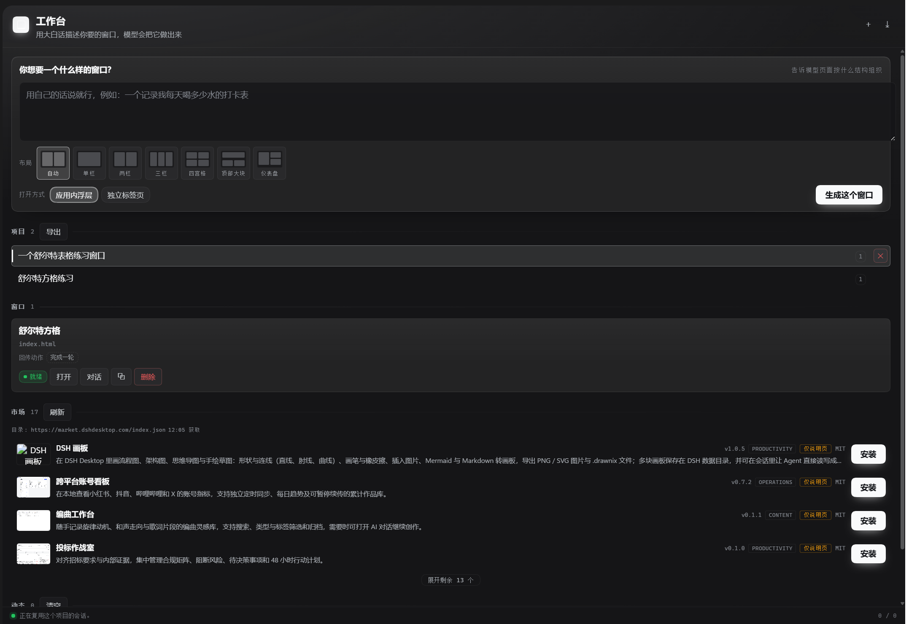
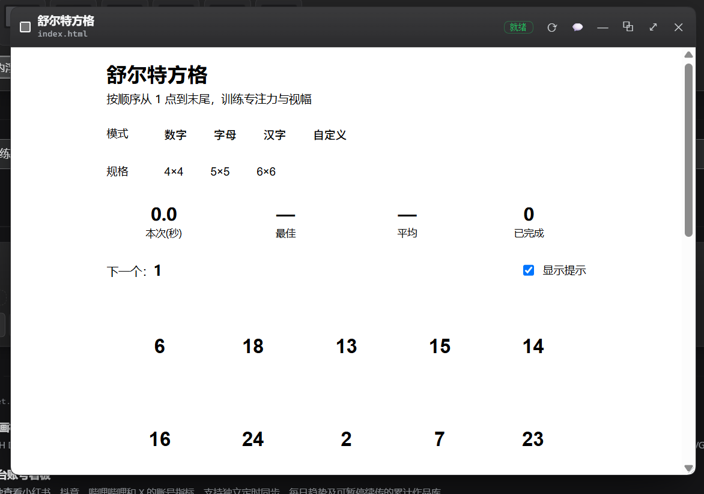
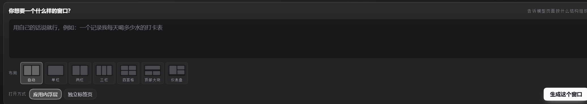
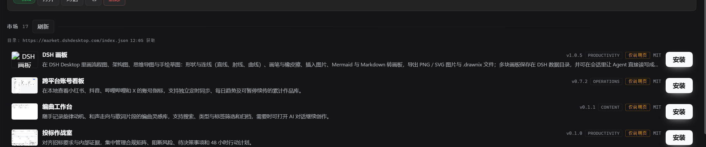

# dsh-ai-workbench · AI 工作台

> **一句话：** 在 DSH 里说一句大白话，AI 就给你造一个能长期存在的窗口——然后你继续跟它聊，它继续改。

<p align="center">
  <a href="docs/video/dsh-ai-workbench-intro.mp4">
    
  </a>
  <br />
  <em>▲ 35 秒介绍视频（1.5× 节奏，含配乐）：<a href="docs/video/dsh-ai-workbench-intro.mp4">点这里播放</a>（1080p，2.5 MB）</em>
</p>

<p align="center">
  
  <br />
  <em>▲ 图 1 · 中央面板：一句需求 → 几个问题 → 一个窗口</em>
</p>

你在侧边栏的「AI 工作台」里写下「我要一个记录每天喝水的打卡表」。工作台先问你几个
小白也能答的问题（要不要每周自动总结？想要什么风格？主要用来干什么？），你确认之后，
模型把一张自包含的单文件 HTML 写进项目文件夹，插件自动把它挂成一个可缩放、可拖动的
窗口。窗口右边有一个绑定的对话窗，你可以在那儿继续让它改；窗口里点了关键按钮，这条
动作连同数据会记进面板的「动作」列表给你看（不会自动送给模型，你提一句它就知道了）。

不用写代码，不用装构建工具，也不用离开 DSH。

<p align="center">
  
  <br />
  <em>▲ 图 2 · 浮层窗口：产物本身就是一个窗口，标题栏能刷新、调不透明度、最小化、全屏</em>
</p>

| 想做什么 | 去哪一节 |
| --- | --- |
| 30 秒装上跑起来 | [安装](#安装) |
| 看它长什么样、能干什么 | [四个区域](#四个区域) + 上面的图 |
| 一句话 → 一个窗口 是怎么闭环的 | [动作上报：只发关键动作](#动作上报只发关键动作) |
| 装别人做好的工作台 | [模板市场](#模板市场) |
| 给模型配的 `workbench_window` 工具 | [给模型用的工具 `workbench_window`](#给模型用的工具workbench_window) |
| 所有可改的配置项 | [配置](#配置) |
| 为什么这样设计、踩过哪些坑 | [设计取舍](#设计取舍为什么是这样) · [踩坑清单](#踩坑清单) |

---

## 它解决什么问题

DSH 里已经有对话，但对话是线性的。你想要的是一个**长期存在的界面**：一个看板、
一个打卡表、一个小计算器、一个能盯着某件事的面板。这类东西让模型每次用文字回答都
很别扭——它会重复输出同一段 HTML，你还得自己另存、自己打开。

这个插件把那条路打通了：

1. 你说一句需求。
2. 工作台问几个具体问题（可选，可跳过），你确认。
3. 模型在项目文件夹里写一个 HTML 文件。
4. 插件读同目录的 `_workbench.json`，知道入口文件和哪些动作值得上报。
5. 窗口以 iframe 挂进 DSH 的浮层，跟着主题走，可拖动、可缩放、可全屏。
6. 窗口右侧的对话窗绑定同一个会话，你可以说「把颜色改成蓝色」。
7. 你在窗口里点了一个**被声明过**的按钮 → 动作连同数据记进面板的「动作」列表 →
   你在对话里说一句「我刚点了完成一格」→ 模型据此改文件 → 窗口刷新。

第 7 步是这个插件和「让模型输出一段 HTML」最大的区别：你不用再复述页面的样子。但要说
准确：**动作是记给你看的，不会自动送到模型那里** —— 你得提一句它才知道。第 2 步是「小白
能用」的关键：绝大多数人说不出自己想要什么，但能回答「你主要用它记录什么」。

<p align="center">
  
  <br />
  <em>▲ 图 3 · 先问后建：5–7 个带推荐选项的问题，可跳过</em>
</p>

---

## 四个区域

### 侧边栏「AI 工作台」行

`sidebar.panellist` 上的一个图标行（order 56，排在已装插件之后）。点它，
中央面板切换成工作台；再点一次会话图标就回到对话。

### 中央面板（创作面）

- **需求输入框**：唯一必须填的东西。Enter 发送，Shift+Enter 换行。
- **提问区（intake）**：写完需求后，面板先列出 5–7 个问题，每题带几个推荐选项，
  也可以自己补一句话。确认后才发给模型。点「就按描述做」可以跳过，让模型在构建时
  自己问。
- **项目列表**：一个项目 = 一个文件夹 = 一个模型会话。换项目就是换上下文。
- **窗口列表**：每个窗口显示标题、入口文件、声明的动作、状态徽章、💬 对话按钮。
- **导入 / 导出**：把整个工作台导出成一个 `.dshwb.json` 文件（页面已内联，可直接
  发给别人），或从文件导入。同一个文件导入两次会得到两个工作台。
- **模板市场**：拉 `market.dshdesktop.com` 的目录，一键装别人做好的工作台。
- **动态**：Host 记的日志，实时推送（SSE），显示「已发出 / 已送达」计数（见[动作上报](#动作上报只发关键动作)一节的说明）。
- **底部状态**：SSE 是否连着、当前项目绑的是哪个会话。

### 浮层窗口（产物面 + 对话面）

`shell.overlay` 上的浮层。每个窗口是一张可拖动的卡片，里面左边是 iframe，右边
（点 💬 展开）是绑定的对话窗。标题栏有对话、最小化、全屏、重新加载、关闭。右下角
可拖拽改尺寸。关掉窗口只是不显示，文档还在账本里，随时能再打开。

对话窗绑的是**项目**而不是窗口：一个项目一份文件夹、一个会话、一份 manifest，所以
同项目的两个窗口共享同一份转录——这是诚实的模型，不是偷懒。

窗口标题栏的「打开方式」有两种，鼠标悬停在芯片上会显示各自适合的场景：

| 打开方式 | 悬停说明 | 什么时候用 |
| --- | --- | --- |
| 应用内浮层 | 浮在本面板上方显示；适合边聊边看的窗口 | 要盯着它同时继续聊天的看板、通知板 |
| 独立标签页 | 在浏览器独立标签页打开；适合要全屏用一阵的窗口 | 表格、编辑器、要专心用十分钟的工具 |

### 内置作者技能

插件启动时会往 DSH 的技能注册表里注册一个内置技能 `ai-workbench-authoring`。它包含
产物契约、主题变量白名单、沙箱陷阱、动作上报协议、响应式要求、前端设计原则、反模式
清单和 10 个可查的资源站点。模型在写工作台页面时能直接读到它，**不需要你单独安装
任何技能**。

---

---

## 模板市场

除了自己造，还能一键装别人做好的工作台。面板上的「市场」拉
`market.dshdesktop.com/index.json`，把每条列成一张卡片：标题、作者、版本、体积、
md5/sha256、有没有能直接跑的静态页。点「安装」走的是和「导入 `.tgz`」**完全相同**的
解包路径：内置零依赖 tar 解包器解开，按排名挑出真正的页面入口，落成本地项目。

<p align="center">
  
  <br />
  <em>▲ 图 4 · 模板市场：标题、作者、版本、能否直接运行一目了然</em>
</p>

安装和删除都会**立即**刷新市场列表——卡片上的「已安装」徽章、可运行标记跟着账本实
时重算，不需要刷新页面，也不会出现「删了还显示已装」的旧状态。

市场包分三种形态，插件不猜、不装样子，卡片上直接标出来：

| 形态 | 卡片显示 | 装完得到 |
| --- | --- | --- |
| 自带构建产物的静态页 | `可直接运行` | 一个能立刻打开的窗口 |
| 纯 dsh-desktop 组件（需要 `desktopWorkbenches` 服务） | `仅描述页` | 一页「这是谁做的、怎么装回去」+ **「让 AI 搭建」按钮** |
| 页面壳引用缺失的构建产物 | `仅描述页` | 同上——这种比上一种更危险，因为它**假装 ready** |

第三种是真实存在的（比如 `standalone/index.html` 引用 `/assets/standalone.js`，而那个
文件要 `npm run build` 才会有）。插件用 `referencesMissingAssets()` 把这种壳降级成描述
页路线，而不是端给用户一个卡死的加载页。「让 AI 搭建」按钮就是它的出路：模型读包源
码，在你的项目文件夹里写出一个自包含的 `index.html`。

> **网络说明：** 市场包托管在 GitHub Releases。如果 `github.com` 不通（常见于国内网
> 络），插件会自动改用镜像重试，并把镜像的耗时放宽到 180 秒——直连仍保持 30 秒快速失
> 败，不会让面板卡住。镜像偶发截断时，sha256 校验会**拒绝**而不是给你装一个坏工作台。

---

## 动作上报：只发关键动作

这是刻意做窄的一条通道。页面里写：

```html
<button onclick="parent.postMessage({
  source: 'dsh-ai-workbench',
  action: 'check-in',
  data: { day: '2026-10-18' }
}, '*')">今天喝了</button>
```

并在 `_workbench.json` 里声明：

```json
{
  "title": "喝水打卡",
  "entry": "index.html",
  "ready": true,
  "actions": [
    { "name": "check-in", "label": "打卡", "description": "用户记录今天喝水" }
  ]
}
```

**动作是记录，不是自动提问。** 点击会把动作连同数据记进面板的「动作」列表，并推进
「已发出」计数；它不会自己唤醒模型，也不会自动出现在模型看到的摘要里 ——
`buildWorkbenchSummary()` 只收 `action` / `warn` 级别的日志行，而这种点击记的是 `info`
级、而且不带 payload。你什么时候想让 AI 处理，就在对话窗里说一句「刚打卡了」「把这个月
的数据汇总一下」，顺便把要点说给它。

这条边界是故意的：如果每次点击都自动变成一条发给模型的提示，工作台里每个按钮都会成了
隐形触发器——你按一下「同步」，模型就自作主张开始回答，哪怕你根本没想让它开口。现在的
规则是**只有你亲自在对话里打的字才会到模型那里**。

页面里其他所有交互——展开、切换标签、翻页、输入——都留在本地，不写日志，不消耗 token。

**未声明的动作会被丢弃**，并且记一条 warn 日志。这个判断在父窗口做，不在 iframe
里做：iframe 是不可信内容，它自己说自己「已声明」不算数。声明列表每次都从账本
重读，所以模型改了 `_workbench.json` 之后不需要刷新页面就生效。

消息里的 `source` 字段用于区分来源，父窗口还会校验 `event.source` 确实是某个已知
窗口的 `contentWindow`——别的 iframe 或上层页面伪造不了。

> 面板上的计数器是「已发出 / 已送达」。第二位数的是**对话消息**成功送进模型会话的条数，
> 动作点击只会让第一个数字增长。

---

## 文件放在哪

| 东西 | 路径 |
| --- | --- |
| 账本（项目、窗口、日志、对话） | `<DSH home>/dsh-ai-workbench.json` |
| 产物 | `<DSH home>/ai-workbench/<项目名 slug>/` |
| 页面清单 | 产物文件夹里的 `_workbench.json` |
| 导出的工作台 | 你自己选的位置，后缀 `.dshwb.json` |
| 路由 | `/apps/ai-workbench/api/*`、`/apps/ai-workbench/events` |
| iframe 源 | `/apps/ai-workbench/api/site/<projectId>/<相对路径>` |

`<DSH home>` 的解析顺序：配置里的 `dshHome` → `$DSH_HOME` → `~/.dsh`。

产物文件夹是**你的**：用编辑器、用 git、用别的工具直接改都行，插件下次读页面时
就会看到。账本只记「这个窗口指向哪个文件」，不记文件内容。

**从上一版升级：** 账本文件名从 `dsh-window-forge.json` 改成了
`dsh-ai-workbench.json`。首次启动时如果新文件不存在、旧文件存在，会**读旧文件**继续
用（旧文件保留不删），所以已有项目不会丢。清单文件名同理：先找 `_workbench.json`，
找不到再找 `_forge.json`。

---

## 安装

```bash
# 1. 打包（在项目根目录）
pnpm pack --pack-destination .

# 2. 装进某个 profile
dsh plugin --profile <profile> add ./dsh-ai-workbench-0.8.3.tgz
```

**桌面版（Electron）不能用 CLI 装。** 它对 `--profile desktop` 会直接报：

```
error: profile "desktop" is managed exclusively by the Electron application
```

桌面场景请走应用内的插件安装入口，选择上面那个 `.tgz`。

> **升级注意：** 这个包改过名字（原 `dsh-window-forge`）。如果旧包还装着，请**先卸
> 旧再装新**。两个包同时启用会各自注册 `/apps/*` 前缀路由，虽然前缀不同不会撞车，
> 但会同时出现两个侧边栏图标、两套账本。见踩坑第 9 条。

想先在隔离环境里试，可以造一个一次性 profile：

```bash
dsh workbench-lab --from-default-profile web --dump-config
dsh plugin --profile workbench-lab add ./dsh-ai-workbench-0.8.3.tgz
dsh --profile workbench-lab --port 0 --no-open
```

最后一行会打印 `http://127.0.0.1:<port>/?token=<token>`，浏览器打开就能看到。

装完重启（或刷新页面），侧边栏底部会多出一个「AI 工作台」图标。

---

## 构建

```bash
node scripts/clean.mjs
node scripts/css-types.mjs        # 生成 CSS Module 的类型 sidecar
node node_modules/typescript/bin/tsc -p tsconfig.json
node node_modules/tsdown/dist/run.mjs
node scripts/verify.mjs
```

`tsc` 只产出 `lib/types/**`（声明文件）；`tsdown` 产出 `lib/index.js`（Host，ESM）
和 `lib/client.js`（浏览器端，CJS 包装成 `__ModuleLoader__` 握手）。

`scripts/css-types.mjs --check` 只比对不写盘，适合 CI。`scripts/verify.mjs` 是静态
契约检查：文件树、manifest、patch 守卫、客户端 bundle 纯净度、三个席位都走
`registry.inject` 注册、协议常量、内置技能是否进包、两份字典的键对齐、CSS 类名对账。
它不构建、不安装、不启动任何东西。

### 本机的坑

`pnpm` 的全局 shim 是坏的（`pnpm: the global target of the pnpm shim points back at
the shim`）。所以：

- 构建脚本一律用**直接调 node** 的方式，不要 `npx` / `pnpm run`。
- `dsh plugin` 需要 pnpm，把真实 pnpm 目录放在 PATH 最前面即可：

```powershell
$env:PATH = 'C:\Users\<you>\AppData\Local\pnpm\global\v11\<hash>\node_modules\pnpm;' + $env:PATH
```

桌面应用内的插件管理器不受影响——它用自己的 pnpm，不走 PATH。

---

## 配置

`Config` 会被 DSH 自动投影成设置页，不需要自己写界面。面板上的开关状态由 Host 通过
`GET /state` 的 `features` 字段下发，不在浏览器里存第二份——你在设置页改完，刷新面板
就生效。

| 键 | 默认 | 说明 |
| --- | --- | --- |
| `dshHome` | `''` | 覆盖 DSH 家目录；空则按上面的顺序解析 |
| `ledgerFile` | `dsh-ai-workbench.json` | 账本文件名 |
| `serveHttp` | `true` | 关掉就不注册任何 HTTP 路由 |
| `registerTool` | `true` | 关掉就不注册 `workbench_window` 工具 |
| `registerSkill` | `true` | 关掉就不注册内置作者技能 |
| `interviewFirst` | `true` | 关掉则需求直接进构建，不先提问 |
| `chatPane` | `true` | 关掉则不显示窗口右侧的对话窗 |
| `marketUrl` | `https://market.dshdesktop.com/index.json` | 模板市场目录地址 |
| `journalActions` | `true` | 是否记录动作日志 |
| `maxJournalEntries` | `200` | 日志上限（0–2000） |
| `forwardActionsToSession` | `true` | 保留的旧行为开关：置 `false` 时连这条显式投递请求也会被拒绝（当前界面上的动作点击本来就走记账路径，不受它影响） |
| `maxProjects` | `20` | 项目上限（1–200） |
| `maxWindowsPerProject` | `12` | 单项目窗口上限（1–100） |
| `defaultProjectName` | `工作台项目` | 自动建项目时的名字 |

---

## 给模型用的工具：`workbench_window`

模型可以主动调用它，在你还没打开面板时就把工作台拉起来：

```
[workbench-window]
status=opened
projectId=project-...
project=喝水打卡
folder=C:\Users\you\.dsh\ai-workbench\喝水打卡
reused=false
windows=1
listeners=1
manifest=_workbench.json
ledger=C:\Users\you\.dsh\dsh-ai-workbench.json
revision=12
next=...
```

`action` 有五个值：

| action | 作用 |
| --- | --- |
| `open`（默认） | 打开面板、绑定会话、返回项目信息 |
| `create` | 同上，但允许新建项目 |
| `ask` | 把 `question` 放进工作台的对话窗，然后**停下等你回答** |
| `building` | 把最新窗口标成「生成中」，告诉你它开始动手了 |
| `export` | 把项目导出成 `.dshwb.json` 写到项目文件夹，返回路径 |

`reused=true` 表示那个文件夹本来就是一个项目——模型此时应该编辑现有文件，而不是
推倒重来。`listeners` 是**诚实的订阅者数量**——0 表示没人在看，面板没开。工具调用时
会把调用方的 sessionId 绑到这个项目上，这是插件唯一可靠地知道「用户在看哪个会话」的
途径（`shell.overlay` 是 root 作用域的席位，拿不到会话上下文）。

工具**不接收页面内容**。页面由模型自己用文件工具写进 `folder`，这样：
一份内容不会在上下文里出现两次；文件是你的，可以改、可以提交、可以复用。`export`
同理——它写盘并只返回路径，不把 bundle 内容塞进工具结果。

---

## 和 dataelement/dsh-desktop 工作台的关系

`dsh-desktop` 定义了一套工作台包规范（`docs/workbench-standard.zh.md`）：一个工作台
是一个 npm 包，带 `dsh.bundle.patch`、`exports["./client"]`，客户端在 `apply` 里调
`ctx.desktopWorkbenches.register({title, repository, …}, BusinessPanel)` 把自己注册进
桌面壳的分栏里。

**本插件跑在官方 DSH 0.2.1-rc.2 上，这个 build 没有 `desktopWorkbenches` 服务**，所以
做不到运行时注册。做的是**格式级兼容**：

- 能读 `dsh-desktop` 的包：`POST /apps/ai-workbench/api/import/package` 下载 `.tgz`
  （或 `.tar.gz`），用内置的零依赖 tar 解包器解开，取出里面的 HTML 入口和资源文件，
  落成一个本插件的工作台。包里没有 HTML 时，会生成一页「这是谁做的、怎么装回去」的
  描述页，而不是假装成功。
- 能读市场目录：`GET /api/market` 拉 `market.dshdesktop.com/index.json`，校验
  `schemaVersion: 2`、`id === owner/repository`、`url`、`distribution.version` 等字段
  （**fail closed**，任何一条不符就整份目录作废），面板上逐条列出，点「安装」走同一
  条解包路径。
- 能导出成自包含的 `.dshwb.json`，可以发给别人、也可以用文件工具手动塞进任何项目。

做不到的部分会**如实标注**：市场卡片上 `runnable: false` 的条目会显示「仅描述页」
徽章，因为本机没有那个运行时。README 不宣称「已兼容 dsh-desktop 的注册协议」。

---

## 设计取舍（为什么是这样）

**iframe 而不是自己渲染。** 模型产出的是 HTML/CSS/JS，用自己的 DOM 渲染等于写一个
浏览器。iframe 天然隔离样式和脚本，也让「模型写的代码出错」不会拖垮 DSH 本身。

**单文件 HTML。** 没有构建步骤，没有依赖解析，没有 CDN。模型能一次写对的东西，
就不要引入一个工具链。需要多文件也行（`entry` 指向任意相对路径），只是默认推荐
单文件。

**先问后建。** 直接拿一句模糊描述去生成，产出的是「基于猜测的通用页面」，用户丢掉
重来的概率很高。先问 5–7 个具体问题，多一次往返，但答案是真的。这一层在**面板**里
做而不是让模型做，因为面板不需要会话就能用、每次问题一致，而且用户能看见自己在填
什么——这是表单和对话的区别。用户如果跳过了，`buildInterviewText` 会让模型在构建前
自己问一次。

**项目 = 文件夹 = 会话。** 这三者绑定，是因为模型需要一个稳定的工作目录来放产物，
而人需要一个稳定的上下文来追问。换项目 = 换文件夹 = 换会话，语义一致。

**对话窗绑项目，不绑窗口。** 一个项目一份文件夹、一个会话、一份 manifest，所以同一
项目的两个窗口本来就共享上下文。假装每个窗口独立反而会让人以为它们互不影响。

**动作通道做窄。** 每个声明过的动作都会往会话里塞一段文字，消耗 token。如果所有
交互都上报，一个翻页就能烧掉半轮上下文。所以默认什么都不发，页面自己声明；而且就算
发出去也只是记进日志，什么时候真要模型动手，由你在对话里决定。

**账本单文件 + 原子写。** 项目和窗口的元数据很小（几十 KB），一个 JSON 文件够用，
比引入数据库简单得多。写入走临时文件 + rename，读坏了就隔离成
`<name>.corrupt-<timestamp>` 再重建，不阻塞启动。

**客户端不 import 任何 harness 包。** 浏览器端的模块表是冻结的九项
（`react`、`react/jsx-runtime`、`react-dom`、`react-dom/client`、`@deepseek-ai/cordis`、
`@deepseek-ai/dsh-client-store`、`@deepseek-ai/dsh-client-ui-slots`、
`@deepseek-ai/dsh-client-ui-primitives`、`@deepseek-ai/dsh-client-ui-dockkit`）。服务
通过结构化接口 + 运行时类型守卫获取，`@deepseek-ai/*` 只做 `import type`，编译后
不留任何引用。`tsdown.config.ts` 里的 `purityGate()` 会在构建期拒绝任何越界的值导入。

**tar 和 market 自己写，不引依赖。** `node:zlib` 已经给了 gunzip，tar 的 512 字节头
格式四十年没变过，写一个只读解包器（`src/tar.ts`，328 行，带路径逃逸和 gzip bomb
防护）比引一个依赖更可控。市场目录的校验同理——宁可自己写 200 行 fail-closed 的
schema 检查，也不让一份坏目录把面板搞崩。

---

## 踩坑清单

这些都是真的踩过、并且已经在代码或检查里处理掉的。

1. **`dsh.client.inject` 必须写有 `./client` 导出的包。**
   `@deepseek-ai/dsh-client-ui-slots` 在浏览器的模块表里，`require()` 能解析，但它
   **没有 `./client` 导出**，所以启动清单不会为它建行，写进 `inject` 等于什么都没
   排序——静默无效，不报错。`slots` 这个服务真正的提供者是
   `@deepseek-ai/dsh-client-ui-renderer`。`scripts/verify.mjs` 会逐个检查这件事。

2. **别人的席位必须用 `ctx.slots.inject(name, () => register(...))` 注册。**
   `main`、`sidebar.panellist`、`shell.overlay` 全是 shell 自己声明的席位，而第三方
   client half 的 `apply()` 跑在 shell 半体组合之前——裸调 `registry.register()` 直接
   抛 `slot "…" is not declared`（只出现在 console 里，容易漏看）。`inject` 会等声明
   到达再执行注册，声明重建时自动重挂。另外 `sidebar.panellist` 和 `main` 要成对：
   shell 会拒绝选中一个「面板还不存在」的侧边栏行。

3. **`main` 是 `keyed` 槽，`replaceRisk` 是 `shadows-shipped-ui`。**
   它的 key 域里已经占了 `conversation`。用 `ai-workbench` 这样的自有 key，绝不
   复用别人的。

4. **`shell.overlay` 是 `list` 槽，而且 `.layer` 必须 `pointer-events: none`。**
   整层是覆盖全屏的 fixed 容器，只有 `.window` 和 `.launcher` 重新打开指针事件。
   忘了这一条，工作台一挂载整个应用就点不动了。

5. **SSE 的每个事件都有名字，`onmessage` 永远不触发。**
   Host 发的是 `event: state\ndata: {...}`，客户端必须对 `hello`/`state`/`project`/
   `window`/`action`/`log`/`chat`/`open` 逐个 `addEventListener`。新增事件时最容易
   忘的就是这个数组。

6. **CSS Module 的类型要 sidecar。**
   `declare module '*.module.css'` 给的是 `Record<string, string>`，在
   `noUncheckedIndexedAccess` 下每个 `styles.x` 都读成 `string | undefined`，赋给
   `className` 就报错。`scripts/css-types.mjs` 生成的
   `styles.module.css.d.ts` 用显式键覆盖掉通配声明——既修类型，又让拼错类名变成
   编译错误。加类名之后记得重跑。

7. **客户端 bundle 的 `id` 必须等于包名。** 启动清单按包名建图，对不上就是加载了
   一个谁也解析不到的 id。`tsdown.config.ts` 的 `const ID` 是唯一来源。

8. **Host 的 `inject` 故意为空。** 硬 inject 是激活门：声明了但没被提供的服务会
   把 fiber 永久 park，`apply()` 永远不跑，整个页面还会报 `web boot: N entries did
   not activate`。这个插件的每个服务都有降级路径（没有 `webServer` 就只做账本，
   没有 `tools` 就不注册工具，没有 `skills` 就不注册技能），所以一个都不硬依赖，
   全走 `ctx.inject([...], (scope) => ...)`。

9. **重复挂载会让整个应用起不来。** 一个 profile 里如果有两行指向同一个包名，两条
   路由前缀会在组合期撞上，重复的 `(kind, path)` 注册是直接抛错，不是跳过。所以
   `cordis.patch.yml` 里那一行带了 `disabled: !!js` 守卫，并且 `guardRegistration()`
   把注册期的冲突降级成一条 warning。改包名（本版从 `dsh-window-forge` 改过来）时，
   务必**先卸旧包再装新包**，否则两个包各注册一套前缀路由、各开一套账本。

10. **`ctx.sessionController.prompt()` 只接受非空内容。** 空字符串会被
    `gateway/bad-request` 拒掉，而且 `requestId` 是幂等键——重试用同一个 id 不会
    产生第二次投递。

11. **`resolveArtifactPath()` 做两次包含性检查。** 一次是词法上的（挡 `..`），一次
    是 `realpath` 之后的（挡符号链接）。只做前者，一个指向外部的软链接就能读到整
    个磁盘。另外 `.exe`/`.dll`/`.bat`/`.cmd`/`.ps1`/`.sh`/`.node`/`.env` 一律拒绝。

12. **iframe 的 CSP 要放开 `frame-ancestors`。** 产物是从同源的另一条路由加载的，
    但它要嵌在 DSH 页面里。默认的 `frame-ancestors 'none'` 会让它白屏。

13. **账本写入要防抖 + 原子。** 拖窗口会一秒触发几十次 `PATCH`，每次都写盘既慢又
    容易写坏。`flush()` 合并写入，落盘走临时文件 + rename。

14. **拖动窗口的事件监听要挂在 `window` 上。** 指针一动就会离开 38px 高的标题栏，
    挂在元素上会中途丢事件。

15. **`pnpm` 全局 shim 坏了**（见上面的「本机的坑」）。这是本机环境问题，不是插件
    的问题，但会让 `dsh plugin add` 以一个和插件无关的错误失败。

16. **客户端服务在 `apply()` 时还没就绪，必须惰性解析。** shell 的客户端服务
    （`sessions`/`conversation`/`uiWorkspace`）比第三方 client half 晚约半秒组合。
    在 `apply()` 里 `ctx.get()` 一次存下来，拿到的永远是 `undefined`——而且不报错。
    存的必须是 resolver（`() => ctx.get(name)`），用的时候再读。

17. **`conversation.sendSession` 返回 `{kind:'success'|'error'}`，不是 `RemoteResult`。**
    按 `ok===false` 判失败会把真失败当成成功。`SessionFace.prompt` 才是
    `{ok:true,value}/{ok:false,error}`——两个返回形状不同，别混。

18. **模型写完文件不会产生任何账本写入，所以不会有 SSE 事件。** 客户端会永远停在
    「生成中」。修法是读时对账（`src/reconcile.ts`）：`GET /state` 时 Host 读一遍
    `_workbench.json` 和 entry 文件，与账本有差异才写（只写真差异，避免轮询自激）；
    客户端在 `building` 期间每 2 秒轮询一次 `load()`。

19. **任务文本里绝不能让模型裸用 localStorage。** 沙箱 iframe 故意不给
    `allow-same-origin`，origin 是不透明的，任何 localStorage 访问都抛
    SecurityError。最恶性的形态是异常发生在 `complete()` 内部、把 `postAction`
    炸断在动作发出去之前——页面看着正常，闭环就是不通。`task-text.ts` 和内置技能
    都明确要求：状态存内存；要持久化必须整段 try/catch 静默退回内存，绝不打断主循环。

20. **一个文件夹只能是一个项目。** 模型收到建窗任务后会自己调 `workbench_window
    {action:'create', folder:<任务里的文件夹>}`，工具若无条件建项目，账本里就会出现
    第二个指向同一文件夹的空壳，manifest 查询从此有歧义。查重在账本层做
    （`normalizeFolder` 归一化后查重复用），HTTP 面板和模型工具两条路都过这里。

21. **客户端这一代没有 `sessions.create()`。** 想新建会话只有两条路：`uiWorkspace`
    的 workspace 入口（会把用户拖进一个新工作区），或者**让 Host 建**。
    `sessionController.create({cwd})` 在 Host 侧可用，所以 `POST /session` 由 Host
    建会话、把 id 写回项目行，客户端只负责调用。`cwd` 是关键：不传它，模型会把产物
    写到进程工作目录，而不是项目文件夹。

22. **对话窗里模型的回复只能从会话事件日志里读。** 没有「列出这条会话的聊天记录」
    的客户端 API，但 Host 侧 `sessionController.inspect(id)` 能在不激活 agent 的前提
    下读全量事件（它不会开启新回合）。从 `assistant/message` 事件里取 `text` 块，
    时间戳用事件自带的 `time` 而不是 `Date.now()`——这样轮询第二次时按
    `(role, at, text)` 找到同一行，不会把同一条回复每轮追加一遍。

22b. **别把用户在 DSH 里的正常对话吸进工作台。** 项目绑的会话就是用户平时聊天的那
    一个，所以「把最近的 assistant 消息都当工作台回复」会把用户和模型的私聊抄进
    对话窗——0.3.3 实测抓回来两段无关对话。修法是按出站标记配对：只有以
    `[workbench-chat]` / `[workbench-action]` / `【工作台 ·` 开头的用户消息才算
    工作台提问，其后第一条 assistant 消息才是回答。**这里的 `armed` 标志只能被
    带标记的用户消息置位、只能被消费掉的那条回复清除，不能被「无标记用户消息」清掉**：
    harness 会在真实 prompt 之后追加 3 条注入的 `user/message`（runtime context、
    技能目录、时间戳），第一版实现把标志清掉了，结果每条回复都取不到（`added=0`）。
    排查方法：会话存储是 `<DSH home>/sessions/<cwd-slug>/<sessionId>/session.v4.jsonl.zstd`，
    **多帧 zstd**，要按 magic `28 b5 2f fd` 切帧再逐帧 `zlib.zstdDecompressSync`
    （整文件一次解只出第一帧，容易误判成「日志里没有这条消息」）。

23. **面板上的开关不要在浏览器里存第二份。** `interviewFirst` / `chatPane` 来自
    用户改的 Config，Host 通过 `GET /state` 的 `features` 下发。客户端自己存一份的
    后果是：用户在设置页关掉了，面板还在按旧值工作，而且没有任何报错。

24. **`descriptorPage` 里的 `rows` 要显式标注类型。** 在
    `noUncheckedIndexedAccess` 下，`Object.entries` 解构出来的元素是
    `[string, string | undefined]`，直接传给模板会报 TS2345。

25. **改名不能只改包名。** 真正要一起动的是：`package.json` 的 `name`、
    `cordis.patch.yml` 的 `name` 与 `id`、`tsdown.config.ts` 的 `const ID`、
    `protocol.ts` 里的 `ROUTE_API`/`ROUTE_EVENTS`/`LEDGER_FILE_NAME`/`PANEL_ID`/
    `SEAT_ID`/`ACTION_SOURCE`、`locale/*.json` 的命名空间、`messages.ts` 的
    `LOCALE_NS`、`verify.mjs` 里的断言字符串。漏一个的表现各不相同（有的是静默
    不加载，有的是 404），所以 `verify.mjs` 把这些常量都钉住了。

26. **有页面、没窗口行的项目会永远看不见。** 这是 0.3.4 之前真实发生的：模型把
    `index.html` 和 `_workbench.json` 写进了文件夹，但窗口行只在「用户从面板提交
    需求」时才创建，所以从工具路径建出来的项目（以及从旧版迁移过来的项目）有项目行
    却没有任何窗口，面板里列着项目、点进去什么都不显示。根因是 `reconcileWindows`
    原本对没有窗口行的项目直接 `continue`——**它只修补已存在的窗口，从不补建窗口**。
    现在的做法是：没有窗口行、但 entry 文件真的能解析出来的项目，由对账收养
    （`adoptProject`）建一行并记一条 `adopted "…"` 日志。条件是「页面真的存在」，
    空文件夹和缺失文件夹保持无窗口，因为那才是诚实状态。

27. **收养必须能被删除按钮否决。** 上面那条自愈逻辑有个直接的反作用：用户删掉窗口，
    下一次轮询发现文件夹里还有页面，就会把它收养回来——删除按钮看起来是坏的。所以
    删除走 `dismissWindow()` 而不是 `removeWindow()`，它同时在项目行上写
    `windowDismissed: true`，收养路径见到这个标记就不动；而显式新建窗口会清掉标记，
    于是「删掉、再造一个新的」仍然成立。这个字段只认字面量 `true`（手改账本不能用
    truthy 字符串压制收养），清除时删字段而不是写 `false`，好让内存形状和落盘形状一致。

28. **描述页 v1 的自愈必须发生在 serve 时刻，而不是 reconcile 时刻。** reconcile 的
    自愈只写账本里的 `inlineHtml`，但 `handleSite` 是磁盘优先的——磁盘上那一份 v1 描述
    页（带 `desktopWorkbenches` 标记、没有 wb-build 按钮）会继续被端给用户。用户的
    文件夹不该被插件重写（那是模型的领地），所以 serve 侧在「磁盘命中 + text/html +
    `isDescriptorPath(entry)` + 内容含 v1 标记」四个条件同时成立时，现场生成 v2 页返回；
    磁盘文件保持原样。

29. **'no such file' 是 missing，不是 forbidden。** `resolveArtifactPath` 对 ENOENT
    返回 `{reason:'no such file'}`，而旧版 `readArtifact` 把一切 resolve 失败都归为
    forbidden——inline 描述页回退只对 missing 生效，于是「磁盘无根 index.html」的
    包（如 beianbai，真页面在 `standalone/` 且缺构建产物）显式请求
    `/site/:id/index.html` 时拿到 403 而不是描述页。判别标准是原因而非状态码：
    只有越权（路径逃出项目文件夹）和扩展名拒绝才是真正的 forbidden，文件不存在
    统一归 missing。

30. **判断市场包能不能独立运行，看的是包内容，不是愿望。** dsh-desktop 市场的包有
    三种形态：纯 React 组件（需要 `desktopWorkbenches` 服务，我们跑不了）、自带构建
    产物的静态页（能直接开）、页面壳引用缺失构建产物（开了也是卡死的加载页——
    beianbai 的 `standalone/index.html` 引用 `/assets/standalone.js`，而
    `lib/standalone.js` 要 `npm run build` 才有）。第三种比第一种更危险，因为它
    假 ready。所以导入路径用 `referencesMissingAssets()` 把坏壳降级成描述页路线，
    收养路径用磁盘版 `referencesMissingAssetsOnDisk()` 做同一件事；「让 AI 搭建」
    按钮就是为这两种包准备的出路——模型读包源码，在项目文件夹里写出自包含的
    `index.html`。

---

## 更新日志

### 0.8.3（当前）

**只改文档，没有功能变更。** 0.8.2 里我写错了一句：「模型确实看得见这些记录——每次你
发消息时，`buildWorkbenchSummary()` 会把最近 8 条交互记录拼进摘要」。市场维护者在合并
时把它改对了，这一版把仓库里同样的错话一并改掉。

逐处核对过的真实链路：

- `src/routes/api.ts:791-796`：`recordOnly` 为真时写入的日志行是
  `action <动作名> · recorded only — the user decides when to ask the AI`，级别是
  **`info`**，而且**不带 payload**。
- `src/client/store.ts` 的 `relayAction()` 永远传 `recordOnly: true` —— 界面上每一次
  动作点击都走这一支。
- `src/summary.ts:73-84` 的 `projectActions()` 只收 `level === 'action' || 'warn'`，
  `info` 级会被过滤 → 这些行**不会**进入 `buildWorkbenchSummary()`，模型看不到。
- 动作本身（含 `data`）留在客户端 store 的 `actions` 里：面板的「动作」列表看得到，
  也能导出，它只是不流向模型。

准确的说法是：**动作会被记下来给你看，不会自动送到模型那里。** 想让它据此修改，得自己
在对话里说一句。

改动的文件：`package.json` 的 `description`、本文件、市场条目
`data/plugins/Uid-762__dsh-ai-workbench.yml` 的 `tarball`（指向 `v0.8.3`）。

### 0.8.2

**只改文档，没有功能变更。** 起因是市场审核时被指出：文档写「动作回传给模型」，
而代码里并不是这样。

改动的文件：`README.md`（开头流程、第 7 步闭环、「动作回传」整节改名「动作上报」、
`forwardActionsToSession` 配置说明、设计取舍条目）、`package.json` 的 `description`、
市场条目的双语简介。顺带修了 README 里一个既有的断链锚点
（`#给模型用的工具-workbench_window` → `#给模型用的工具workbench_window`）。

这一版有一句话仍然说错了（「模型在下次发言时能看到这些记录」），修正见 0.8.3。

### 0.8.1

模板市场相关的五个问题一次修完，都是用户实际撞到的：

| # | 问题 | 根因 | 修法 |
| --- | --- | --- | --- |
| 1 | 装完市场包，卡片还显示「未安装」 | `installFromMarket()` 置了 `marketBusy=true` 后调 `loadMarket()`，而 `loadMarket()` 第一行就是 `if (state.marketBusy) return`——刷新被自己挡死 | `finally` 里**先**清 `marketBusy`，再 `await loadMarket()` |
| 2 | 删掉工作台，卡片还显示「已安装」 | `deleteProject()` 只刷新项目列表，从不刷新市场，徽标用的是账本里的旧 `installedProjectId` | 删除后 `await load()` 再 `await loadMarket()` |
| 3 | 某些市场工作台装完白屏/半屏 | 市场页的 `localStorage` 调用在**外部 JS 模块**里，而 storage shim 的门禁只在入口 HTML 文本里搜 `localStorage` 字样——搜不到就不注入。沙箱 iframe 是不透明 origin，`setItem` 直接抛 `SecurityError`，模块顶层炸掉，页面半绘 | 去掉文本门禁，shim 注入到**每一个** served HTML 文档 |
| 4 | 「打开方式」两个芯片没有任何说明 | 只有 `aria-pressed`，没有 `title`，字典里也没有解释文案 | `PLACEMENT_CHIPS` 加 `descKey`，悬停显示「浮在本面板上方…」「在浏览器独立标签页…」 |
| 5 | 部分市场包装不上（`did not finish within 30000ms` / `fetch failed`） | 国内网络到 `github.com` 超时，插件有镜像兜底，但镜像复用直连的 30 秒预算，10–90 秒的任务被直接掐断 | 新增 `PROXY_FETCH_TIMEOUT_MS = 180_000`，镜像单独计时；两个都超时时报错区分是谁超时 |

顺带修掉的两个账本健壮性问题：`flush()` 遇到 `EPERM: operation not permitted, rename`
（杀毒软件/OneDrive 瞬时占用）会重试 3 次并退回原地写；重复安装同一个市场包现在复用它
的文件夹并覆盖写入，而不是生成 `<name> 2` 再报 409。

---

## 目录

```
dsh-ai-workbench/
├── package.json              manifest：入口、dsh.bundle.patch、dsh.client
├── cordis.patch.yml          bundle patch（带重复挂载守卫）
├── tsconfig.json             严格模式 + noUncheckedIndexedAccess
├── tsdown.config.ts          Host（ESM）+ Client（CJS 握手）两套配置
├── locale/
│   ├── en.json               安装器读 meta.title / meta.description
│   └── zh.json
├── scripts/
│   ├── clean.mjs             删 lib/（tsdown 是 clean:false，必须先跑）
│   ├── css-types.mjs         从 stylesheet 生成 CSS Module 类型 sidecar
│   └── verify.mjs            静态契约检查
└── src/
    ├── index.ts              Host 装配：账本、路由、工具、技能、设置
    ├── config.ts             schemastery Config schema
    ├── protocol.ts           两半共享的线上契约（常量 + 类型）
    ├── ledger.ts             单文件账本（原子写、损坏隔离、旧账本接管）
    ├── artifacts.ts          产物读取 + 路径安全边界 + 内联页回退
    ├── reconcile.ts          读时对账：manifest/产物 → 账本（building→ready）
    ├── summary.ts            给模型的工作台上下文摘要 + 回复抽取
    ├── bundle.ts             工作台 ↔ .dshwb.json ↔ dsh-desktop 包 的双向映射
    ├── market.ts             市场目录拉取 + fail-closed 校验 + 分发地址推导
    ├── tar.ts                零依赖只读 tar 解包（防路径逃逸、防 gzip bomb）
    ├── skill.ts              内置作者技能正文 + 资源清单 + 精简摘要
    ├── routes/
    │   ├── api.ts            JSON 路由（mini-router，23 条）
    │   └── sse.ts            事件推送
    ├── tools/
    │   └── workbench_window.ts  模型可调用的工具（5 个 action）
    └── client/
        ├── index.tsx         注册 main / sidebar.panellist / shell.overlay
        ├── Panel.tsx         中央面板（需求 + 提问 + 项目 + 窗口 + 导入导出 + 市场）
        ├── Intake.tsx        先问后建的问题表单
        ├── Chat.tsx          窗口右侧的绑定对话窗
        ├── Market.tsx        模板市场列表
        ├── Windows.tsx       浮层窗口（iframe + postMessage 桥 + 对话分栏）
        ├── store.ts          客户端状态容器 + SSE + 会话发送
        ├── task-text.ts      一句话 → 发给模型的提示词（建窗 / 追问 / 精修）
        ├── messages.ts       en/zh 字典 + t()
        ├── use-store.ts      useSyncExternalStore 绑定
        ├── styles.module.css
        └── css-modules.d.ts
```

---

## 许可

MIT

---

## 界面截图

全部截图来自真实运行环境（Windows 11 + DSH 桌面端 0.2.1-rc.2 + 插件 0.8.1，界面在 0.8.2 未变），未做任何修饰：

| 文件 | 展示内容 |
| --- | --- |
| [`docs/screenshots/01-panel.png`](docs/screenshots/01-panel.png) | 中央面板全景：需求输入框、布局/打开方式选择、项目与窗口列表、模板市场、底部状态栏 |
| [`docs/screenshots/02-window.png`](docs/screenshots/02-window.png) | 一个真实工作台窗口（浮层）：标题栏含状态徽标、刷新、不透明度、最小化、对话、全屏、关闭 |
| [`docs/screenshots/03-intake.png`](docs/screenshots/03-intake.png) | 「先问后建」的入口：一句大白话输入框 + 7 种布局预设 + 两种打开方式 |
| [`docs/screenshots/04-market.png`](docs/screenshots/04-market.png) | 模板市场列表：版本号、分类、`仅说明页` 徽章、许可证、安装按钮 |

截图目录的说明见 [`docs/screenshots/README.md`](docs/screenshots/README.md)。深色/浅色各截一套更好：把
`01-panel.png` 存成 `01-panel-dark.png`，在 README 里换源即可（当前是单图，换图不影响文字）。
